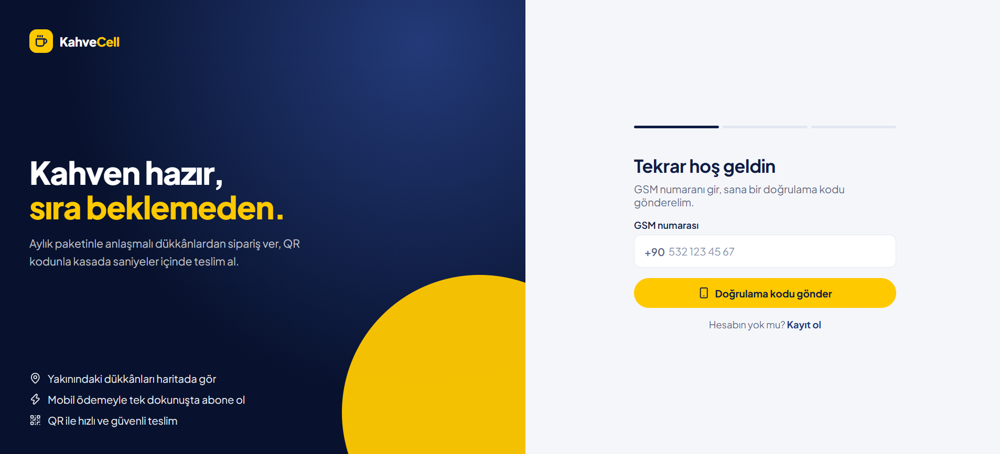
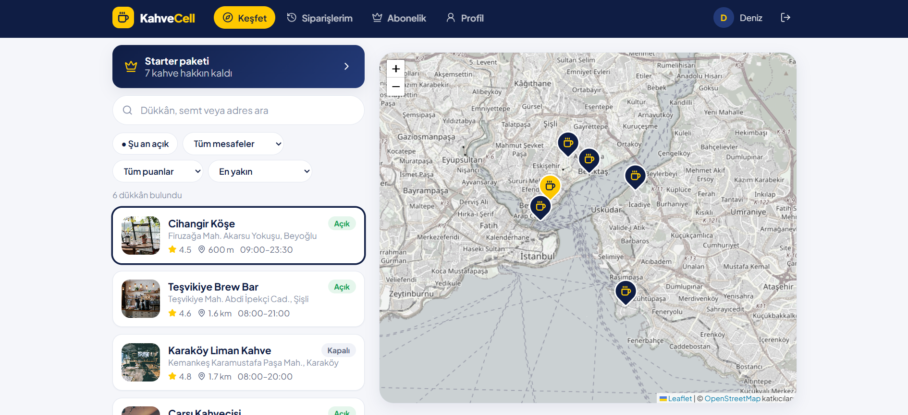
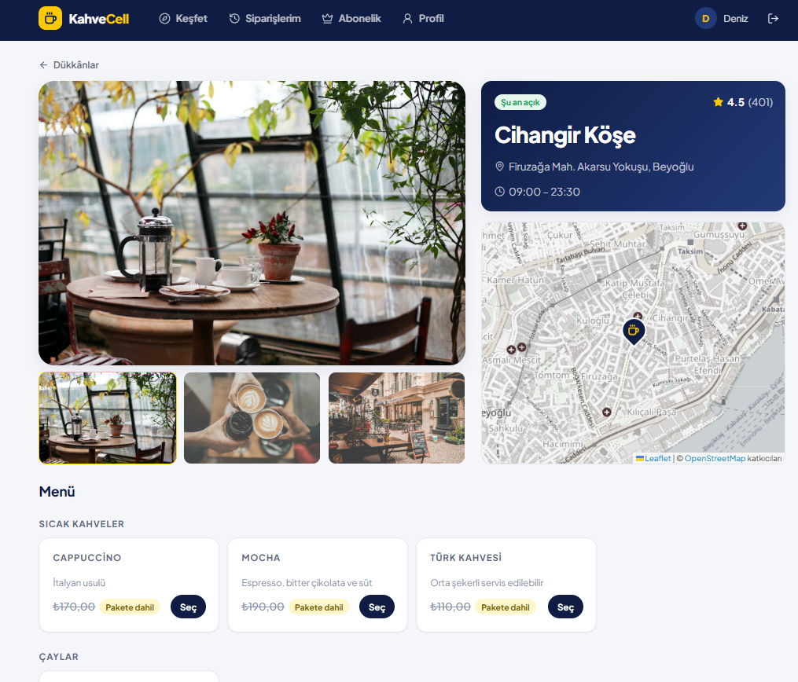
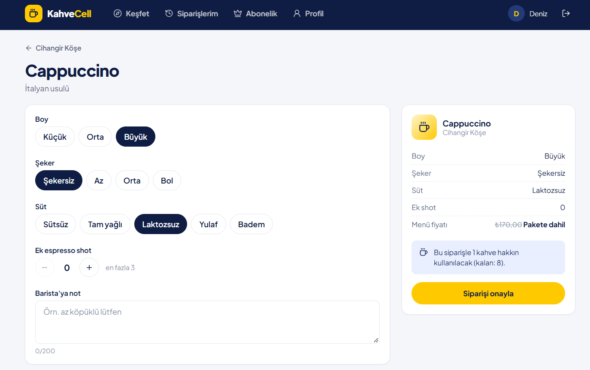
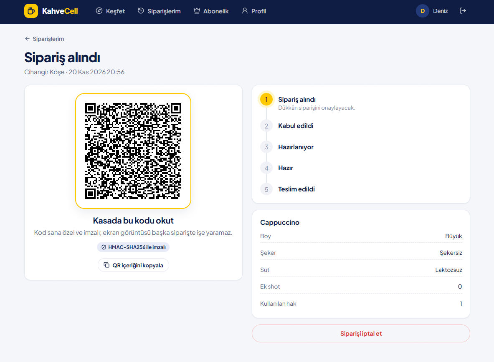
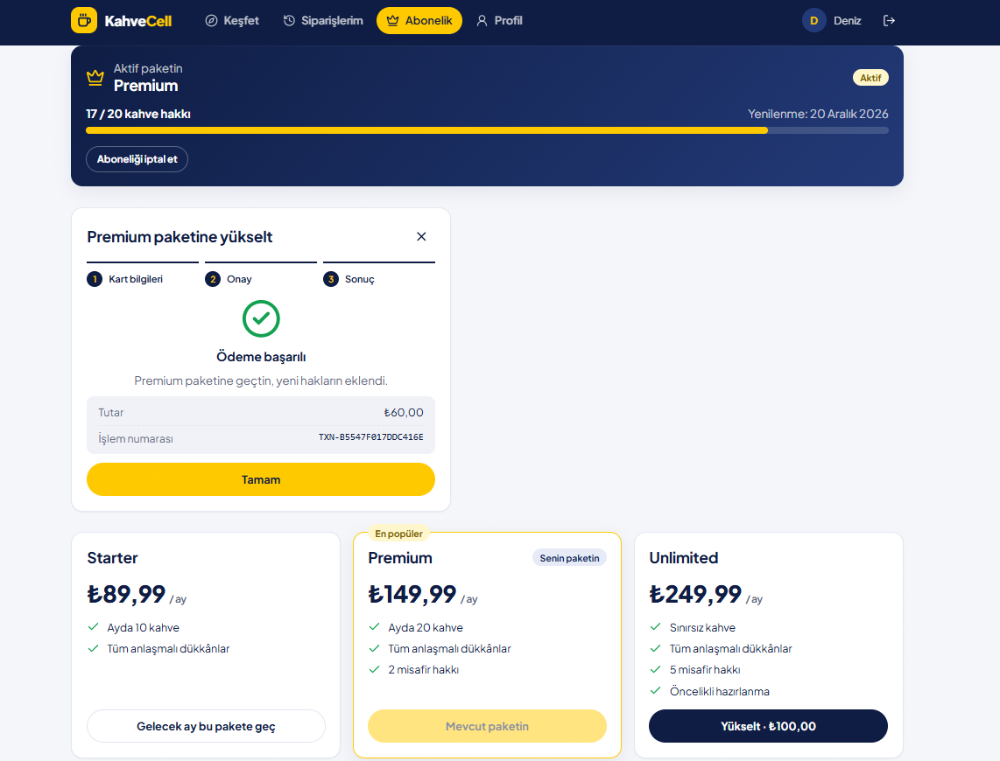
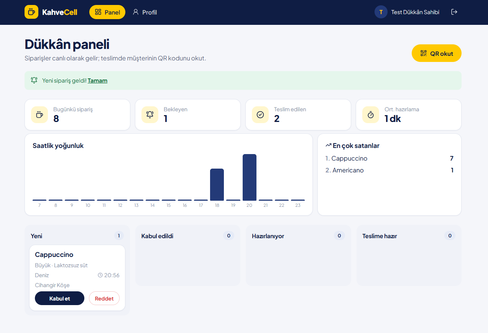
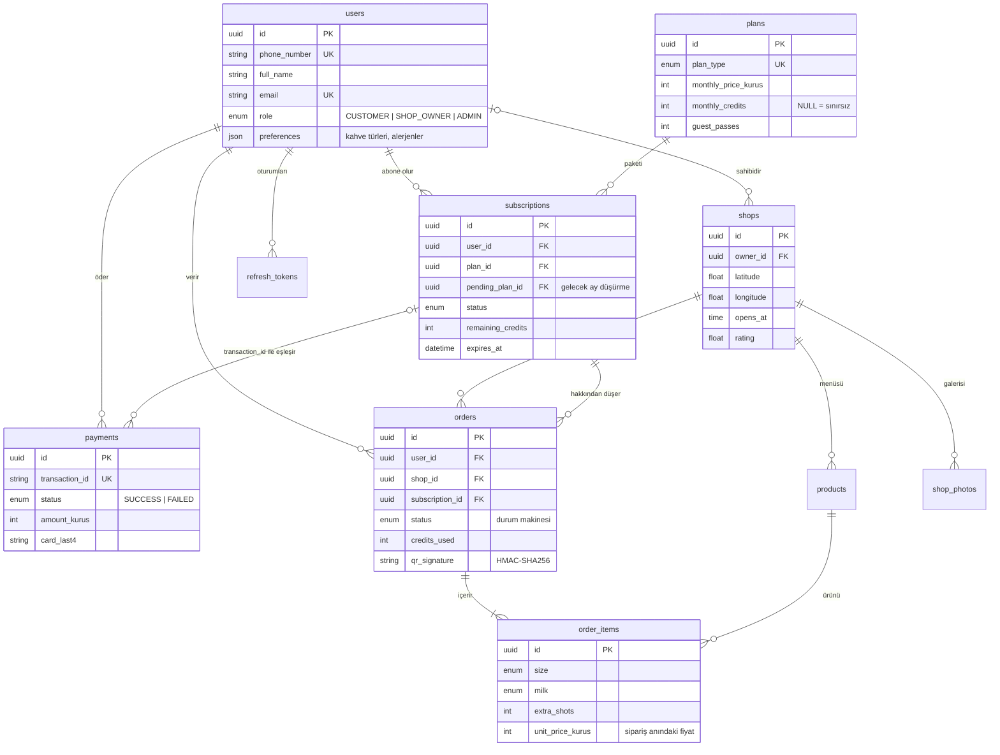
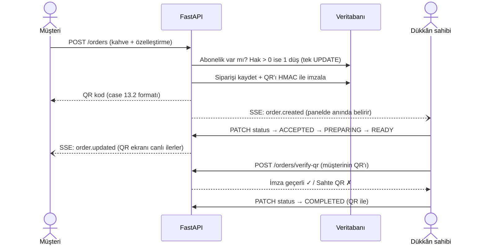

# ☕ KahveCell

[](https://github.com/gokdeniz-gul/Kahvecell/actions/workflows/ci.yml)

**Dijital kahve abonelik platformu.** Operatör aboneleri aylık paket alır, haritadan yakınındaki anlaşmalı dükkânı bulur, kahvesini özelleştirip sipariş verir ve kasada imzalı QR koduyla teslim alır. Dükkân sahibi siparişleri canlı olarak görür, hazırlar ve QR'ı okutarak teslim eder.

> Turkcell Geleceği Yazanlar — Prompt Mühendisliği eğitimi bitirme case çalışması.

| | |
|---|---|
| **Backend** | Python 3.12+ · FastAPI · SQLAlchemy 2.0 · Alembic · PyJWT · pytest |
| **Veritabanı** | PostgreSQL 17 (Docker) · SQLite (yerel geliştirme) |
| **Frontend** | React 19 · Vite · React Router · TanStack Query · Zustand · axios · Vitest |
| **Harita** | Leaflet · OpenStreetMap (API anahtarı gerektirmez) |
| **Altyapı** | Docker Compose · nginx · GitHub Actions |

---

## Özellikler

**Müşteri**
- **Kayıt / giriş:** GSM + SMS OTP (simülasyon, kod `1234`), 30 gün boyunca tekrar kod sorulmaz (refresh token)
- **Profil:** ad soyad, e-posta, sevilen kahve türleri, alerjenler; sipariş ekranında seçilen süt alerjenle çakışırsa uyarı
- **Abonelik:** Starter · Premium · Unlimited — satın alma, yükseltme (fark ödenir, anında), düşürme (gelecek dönem), iptal (dönem sonuna kadar geçerli), aylık yenileme
- **Mobil ödeme simülasyonu:** kart formu → onay ekranı → sonuç; `4242 4242 4242 4242` başarılı, `4000 0000 0000 0002` reddedilir; ödeme geçmişi
- **Dükkân keşfi:** harita, mesafeye göre sıralama (Haversine), Türkçe karakter duyarsız arama, mesafe / puan / "şu an açık" filtreleri
- **Dükkân detayı:** fotoğraf galerisi, puan, mesafe, çalışma saatleri, menü
- **Sipariş:** boy / şeker / süt / ek shot, abonelik hakkından atomik düşüm, favori sipariş tekrarı
- **İmzalı QR + canlı takip:** case 13.2 formatında HMAC-SHA256 imzalı QR; durum değişiklikleri **SSE ile anında** ekrana düşer

**Dükkân sahibi** (`/panel`)
- Gelen siparişler panosu: Yeni → Kabul → Hazırlanıyor → Hazır (Unlimited aboneler öncelikli), yeni siparişler **canlı** düşer
- **QR okutma:** kamera, ekran görüntüsü yükleme ya da metin yapıştırma; sahte QR'da uyarı, gerçekse tek tıkla teslim
- **Günlük analitik:** sipariş sayısı, bekleyen/teslim/iptal, ortalama hazırlama süresi, saatlik yoğunluk, en çok satanlar

---

## Ekran görüntüleri

| Giriş (GSM + OTP) | Keşfet: harita, filtreler, yakındaki dükkânlar |
|---|---|
|  |  |
| **Dükkân detayı: fotoğraf galerisi, konum, menü** | **Sipariş: kahve özelleştirme** |
|  |  |
| **İmzalı QR ve canlı durum takibi** | **Abonelik: paket yükseltme ve ödeme sonucu** |
|  |  |

**Dükkân sahibi paneli:** günlük analitik, canlı sipariş panosu, QR ile teslim



---

## Hızlı başlangıç

### Seçenek A — Docker (tek komut)

```bash
docker compose up --build
```

- Uygulama: **http://localhost:8080**
- Swagger: **http://localhost:8080/docs**
- PostgreSQL + FastAPI + nginx ayağa kalkar; migration'lar ve demo verisi otomatik yüklenir.
- Uçtan uca kontrol: `python backend/scripts/smoke_test.py http://localhost:8080`

### Seçenek B — Yerel geliştirme

Gereksinimler: **Python 3.12+**, **Node.js 20+**

```bash
# 1) Backend
cd backend
python -m venv .venv
.venv\Scripts\activate          # macOS/Linux: source .venv/bin/activate
pip install -r requirements.txt
cp .env.example .env            # Windows: copy .env.example .env
python -m scripts.seed          # migration'lar + paketler, 6 İstanbul dükkânı, test hesapları
uvicorn app.main:app --reload   # http://127.0.0.1:8000  ·  Swagger: /docs

# 2) Frontend (ayrı terminal)
cd frontend
npm install
npm run dev                     # http://localhost:5173
```

### Test hesapları

Tüm hesaplarda doğrulama kodu **`1234`**.

| Rol | Telefon | Ne yapabilir |
|---|---|---|
| Müşteri | `5551234567` | Aktif Starter aboneliğiyle sipariş verir |
| Dükkân sahibi | `5559876543` | 6 dükkânın paneli: siparişleri yönetir, QR okutur, analitiği görür |
| Admin | `5550000000` | Kullanıcı listesi, rol değiştirme, tüm dükkânların paneli |

> **Demo ipucu:** Müşteriyi normal pencerede, dükkân sahibini gizli pencerede açın. Müşteri QR ekranındaki "QR içeriğini kopyala" ile kopyalayıp dükkân panelinde "QR okut → Metin yapıştır" ile teslim edebilirsiniz; durum değişiklikleri iki pencerede de anında görünür.

### Testler

```bash
cd backend && pytest                                  # 173 test (SQLite)
cd frontend && npm test && npm run lint && npm run build   # 52 test
```

CI'da backend testleri **SQLite ve PostgreSQL** üzerinde, ardından Docker Compose ile tüm sistem ayağa kaldırılıp uçtan uca duman testi koşar.

---

## Mimari

```
                    ┌────────────────────── Docker Compose ──────────────────────┐
┌──────────────┐    │ ┌────────────┐  /api   ┌──────────────────────┐            │
│ Tarayıcı     │───►│ │ nginx      │───────► │ FastAPI              │   ┌──────┐ │
│ React (SPA)  │◄───│ │ statik dosya│◄─SSE─── │  api/v1  → router    │──►│ Post │ │
└──────────────┘    │ └────────────┘         │  services → kurallar │   │ greSQL│ │
                    │                         │  repositories → SQL  │   └──────┘ │
                    │                         └──────────────────────┘            │
                    └─────────────────────────────────────────────────────────────┘
```

**Katmanlı yapı:** endpoint'ler HTTP ile, servisler iş kurallarıyla, repository'ler veritabanıyla ilgilenir. Servisler HTTP bilmez; `NotFoundError` gibi anlamlı hatalar fırlatır, global handler bunları standart cevaba çevirir:

```json
{ "success": false, "data": null, "error": { "code": "NO_CREDITS_LEFT", "message": "Bu ayki kahve hakkınız bitti...", "details": {} } }
```

### Veritabanı



Ayrıca: `products`, `shop_photos`, `otp_requests` (OTP özetleri), `refresh_tokens` (oturum özetleri).

### Sipariş akışı



**Tablolar:** `users` · `plans` · `subscriptions` · `payments` · `shops` · `shop_photos` · `products` · `orders` · `order_items` · `otp_requests` · `refresh_tokens`

- Şema **Alembic migration'larıyla** sürümlenir (`backend/migrations/`); uygulama açılırken `upgrade head` otomatik çalışır. Bir test, migration'ların modellerle birebir aynı olduğunu doğrular.
- UUID primary key'ler, foreign key / CHECK / UNIQUE kuralları veritabanı seviyesinde
- Para **kuruş** cinsinden tam sayı, tarihler UTC
- Kullanıcı başına tek geçerli abonelik (partial unique index)
- Sipariş anındaki fiyat `order_items`'a kopyalanır

```bash
alembic revision --autogenerate -m "aciklama"   # model değişikliğinden yeni migration
alembic upgrade head                            # şemayı güncelle
```

### Önemli kararlar

| Konu | Karar | Neden |
|---|---|---|
| Ödeme akışı | `POST /payments/process` → `transaction_id` → `POST /subscriptions` | Case 12: transaction ID eşleştirmesi; ödeme tek kullanımlık, kullanıcı/paket/tutara göre doğrulanır |
| Tutar | Sunucu hesaplar | İstemci tutarı değiştiremez |
| Kahve hakkı | Tek SQL `UPDATE ... WHERE remaining_credits > 0` | Çift tıklamada bile hak iki kez harcanamaz |
| Yakınlık | Enlem/boylam index'iyle kutu ön elemesi + Haversine | SQLite'ta spatial index yok; PostGIS'e geçiş kolay |
| Refresh token | Rastgele, SHA-256 özeti saklanır, tek kullanımlık | Çalınan eski token kullanılırsa tüm oturumlar kapanır |
| QR imzası | HMAC-SHA256, JWT'den ayrı anahtar | Anahtarı bilmeyen geçerli QR üretemez |
| Teslim | Sadece QR okutularak | Case 7.3; dükkân "teslim edildi"yi elle işaretleyemez |
| Canlı takip | SSE (Server-Sent Events) | Tek yönlü bildirim için WebSocket'ten basit; proxy dostu, otomatik yeniden bağlanır |
| Frontend verisi | Sunucu verisi React Query'de, oturum Zustand'da | Önbellek, yükleniyor/hata durumları ve yeniden deneme hazır gelir |

---

## API özeti

Tam liste ve canlı deneme: **`/docs`** (Swagger, otomatik üretilir).

| Grup | Endpoint'ler |
|---|---|
| Auth | `POST /auth/register` · `/login` · `/verify-otp` · `/refresh` · `/logout` |
| Kullanıcı | `GET` / `PATCH /users/me` · `GET /users` (admin) · `PATCH /users/{id}/role` (admin) |
| Abonelik | `GET /subscriptions/plans` · `POST /subscriptions` · `GET` / `PATCH` / `DELETE /subscriptions/me` |
| Ödeme | `POST /payments/process` · `GET /payments/me` |
| Dükkân | `GET /shops?lat=&lng=&radius_km=&q=&open_now=` · `GET /shops/{id}` · `GET /shops/{id}/menu` |
| Sipariş | `POST /orders` · `GET /orders/{id}` · `GET /orders/history` · `POST /orders/{id}/reorder` |
| Dükkân paneli | `GET /orders/incoming` · `PATCH /orders/{id}/status` · `POST /orders/verify-qr` · `GET /orders/stats` |
| Canlı (SSE) | `GET /orders/{id}/events` · `GET /orders/incoming/events` |

---

## Güvenlik

- Refresh token ve OTP kodları **özet (hash)** olarak saklanır; kart numarası hiç saklanmaz ve loglanmaz
- `/auth/*` ve `/payments/process` için **IP başına dakikalık istek sınırı** (429 + `Retry-After`)
- Güvenlik başlıkları, API cevaplarında `Cache-Control: no-store`, CORS sadece tanımlı adreslere
- `ENVIRONMENT=production` iken varsayılan / yer tutucu / kısa / aynı JWT ve QR anahtarlarıyla **uygulama açılmaz**
- SSE bağlantısındaki token **loglarda maskelenir** (`?token=***`)
- Her isteğin bir kimliği (`X-Request-ID`) vardır; 500 hatalarında kullanıcıya sadece bu kimlik döner, ayrıntı loglarda kalır
- CI'da bağımlılıklar `npm audit` / `pip-audit` ile tarandı, bilinen açık yok

> ⚠️ `config.py` içindeki varsayılan anahtarlar **yalnızca geliştirme** içindir. Üretimde `.env` ile değiştirin:
> `python -c "import secrets; print(secrets.token_urlsafe(48))"`

**Loglama:** `LOG_FORMAT=json` ile her satır bir JSON nesnesi (`request_id`, `method`, `path`, `status`, `duration_ms`); Docker'da varsayılan olarak açık.

---

## Bilinen sınırlar ve yol haritası

- **Ölçekleme:** canlı bildirim kanalı ve rate limit sayaçları bellekte (tek süreç). Çoklu sunucuda Redis Pub/Sub ve Redis sayaçlarına taşınmalı.
- Token'lar tarayıcıda `localStorage`'da; üretim için httpOnly cookie değerlendirilebilir.
- Case 3.5'teki diğer bonuslar henüz yok: arkadaşa kahve ısmarlama (misafir hakkı altyapısı hazır), öneri motoru, push bildirim.

---

## Görseller

Dükkân fotoğrafları [Unsplash](https://unsplash.com) kaynaklıdır ve [Unsplash Lisansı](https://unsplash.com/license) ile kullanılmıştır; dükkân adları hayalîdir. Ayrıntı: [`frontend/public/images/shops/CREDITS.md`](frontend/public/images/shops/CREDITS.md). Harita: © OpenStreetMap katkıcıları.

---

## Proje yapısı

```
kahvecell/
├── docker-compose.yml
├── docs/screenshots/        # README ekran görüntüleri
├── .github/workflows/ci.yml
├── backend/
│   ├── app/
│   │   ├── api/v1/        # endpoint'ler (router)
│   │   ├── core/          # ayarlar, veritabanı, güvenlik, QR, hata yönetimi, rate limit,
│   │   │                  # loglama, SSE olay kanalı, migration çalıştırıcı
│   │   ├── models/        # SQLAlchemy tabloları
│   │   ├── schemas/       # Pydantic istek/cevap şemaları
│   │   ├── services/      # iş kuralları
│   │   ├── repositories/  # veritabanı sorguları
│   │   └── utils/         # Haversine, Türkçe arama normalizasyonu
│   ├── migrations/        # Alembic
│   ├── scripts/           # seed.py (örnek veri), smoke_test.py (uçtan uca kontrol)
│   ├── tests/             # pytest
│   └── Dockerfile
└── frontend/
    ├── src/
    │   ├── api/           # axios istemcisi + endpoint fonksiyonları
    │   ├── components/    # layout, harita, QR okuyucu, sipariş kartı, durum ekranları
    │   ├── pages/         # 10 sayfa (müşteri, profil, dükkân paneli)
    │   ├── hooks/         # konum, abonelik, canlı olay akışı (SSE)
    │   ├── lib/ store/ styles/
    │   └── router.jsx     # lazy yüklenen sayfalar, rol bazlı yönlendirme
    ├── nginx.conf
    └── Dockerfile
```
